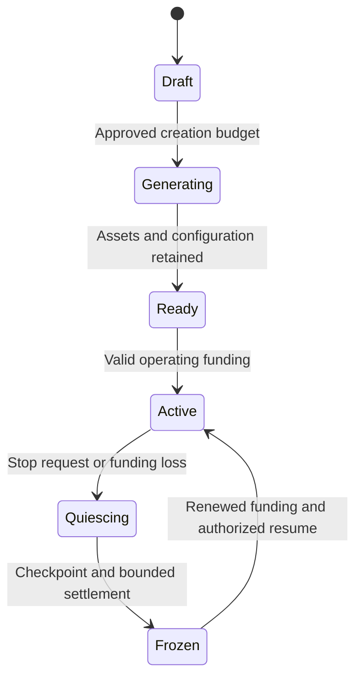

# Generated objects, persistent NPCs, and funding

Decision date: 2026-10-17. Requested by the repository owner during engine implementation. This is a dependency-ordered scope extension, not a claim that these features already exist. All original 145 units remain; G01–G16 add reusable engine behavior and C27–C41 add XLR8 billing/product behavior. The expanded plan has 176 units: 135 engine and 41 application.

## Repository and release boundaries

The engine owns creation intents, provider adapters, assets, rigs, animations, NPC behavior, conversational interfaces, spatial speech, private memory, usage measurements, budget reservations and lifecycle checkpoints. Its host supplies identity, capabilities and an operating-budget decision. An independent game or education application can use the same packages.

XLR8 owns platform-credit prices, wallets, monthly plans, paid NPC slots, administrator exemptions, subscriptions to creators' NPCs, payments and revenue allocation. The engine does not import those business rules. Payment-provider terminology does not become the engine's data model.

Engine completion still precedes XLR8 implementation: C01 depends on R12. R12 additionally depends on G16, which qualifies the new engine scope. The application rehearsal C24 additionally depends on C41 so existing release/deployment gates include the credits and NPC journeys. No engine unit depends on an application unit. All new units start planned; adding this document does not accept their implementation.

## Creation experience

A user can type or speak, for example, “Conjure an Einstein NPC to explain spacetime to me.” The intent resolver proposes a structured specification: a humanoid, an English conversational persona, visual references, rig/animation requirements, a voice, knowledge scope and the selected world/owner. Ordinary objects use the same intent and asset pipeline while omitting the conversational and humanoid stages.

Before a paid provider job starts, the host shows an itemized creation quote and a maximum approved charge. It also asks the creator to choose an operating mode and cap, or an available NPC slot. The quote can cover the complete pipeline while allowing optional approval of reference images before model generation. A changed specification, additional retries or a higher maximum cost requires a new approval; completed paid stages remain reusable.

The image adapter creates consistent front, back, side and three-quarter views with the same costume, proportions and neutral rest pose. It retains the reference set and prompt/model versions. Rodin generates the textured mesh. The pipeline validates and normalizes that mesh, sends an appropriate humanoid GLB to Meshy, imports its rig and selected animations, then runs the ordinary optimization/collision/publication pipeline. Original and derived assets remain available for editing, reuse and export. Missing limbs, poor deformation or unsupported bodies get repair/alternate-rig diagnostics; a supplier limitation does not remove the engine's object or creature capabilities.

### Current provider integration facts

Rodin's documented Gen-2.5 endpoint accepts one to five ordered reference images; the first influences material generation. The adapter must explicitly select its tier because omission selects an older family. Generation is asynchronous, with status and result-download operations. Provider credit units are wholesale accounting inputs, not platform credits. [Rodin generation](https://docs.hyper3d.ai/en/api-specification/rodin-gen2-5), [status](https://docs.hyper3d.ai/en/api-specification/check-status), [download](https://docs.hyper3d.ai/en/api-specification/download-results).

Meshy's documented rigging API accepts externally supplied textured humanoid GLB through `model_url`; the declared front must face +Z. Its programmatic rigging documentation currently qualifies standard bipeds. This supports the requested Rodin-to-Meshy humanoid route, subject to actual asset testing. The animation API consumes a successful rigging task and returns animation assets. Body rigging does not establish facial/viseme support; that is a separately qualified adapter. Download and retain outputs before provider expiry. [Rigging API](https://docs.meshy.ai/en/api/rigging), [Animation API](https://docs.meshy.ai/en/api/animation).

These are documented interfaces checked on 2026-10-17, not live-integration acceptance. G03–G05 require real provider tests at the selected source/API versions. We do not fix retail prices to a scraped price or assume a provider account's prepaid credit denomination equals dollars.

## NPC conversation, personality and memory

An NPC has a durable ID and versioned persona, asset, rig, voice and behavior configuration. World instances and conversations reference that identity. The Einstein preset is an AI portrayal with an English vocabulary/style profile and a declared knowledge policy. Curated sources support factual explanations; persona style does not make invented statements historically authentic. Creators can define fictional or original personalities as well.

The conversational service uses a replaceable LLM and bounded tools for permitted world interactions. The server authorizes each action independently of model output. A prompt, retrieved document or conversation cannot grant spending authority, administrator privileges, private-memory access or arbitrary script execution.

Memory has three explicit scopes: creator-authored knowledge, deliberately shared NPC/world knowledge, and private conversation context associated with a particular visitor. Ownership or subscribing does not reveal other visitors' private conversations. Memories carry provenance and can be inspected, corrected, forgotten or exported by the appropriate principal. Summaries and embeddings obey the same access and deletion rules as their source. Compaction, retrieval and embedding costs are metered; context is bounded rather than appended indefinitely.

Speech uses the existing spatial-audio graph. The NPC's voice follows its avatar/entity, obeys distance and acoustic settings and stops on interruption. Text, captions, gestures and optional lip-sync share the speech session's timing. The implementation supports text-only participation and a simpler facial-animation fallback when the rig lacks suitable shapes.

## One-time creation and ongoing operation

The user-visible split is **one-time creation** versus **ongoing operation**. Creation may include reference images, 3D generation, rigging, animations, compilation, preview storage and approved retries. Operation may include LLM input/output, speech recognition/synthesis, retrieval/embeddings, memory/storage, active simulation and media/network resources.

NPCs do not require a permanently running LLM process each. Durable identity and stored memory survive while inference runs only for authorized work. An active service tier can include availability and resource allowances, and its quote must explain those recurring costs. Dormancy stops new paid inference/voice/background jobs; it is not a promise that storage has no cost to the company. The published retention policy defines preserved dormant data, and financial failure never silently deletes an NPC.

For each priced operation, the application computes a versioned estimate from provider/resource units and records its pricing inputs. The initial default is a configurable 2x cost markup. If `C` is the eligible cost estimate, `m` the configured multiplier and `v` the currency value of one platform credit, the customer amount is `ceil_to_credit_unit(m × C / v)`, with clearly specified treatment of taxes and payment fees. Rounding uses integer minor units. Historical transactions retain their original pricing version.

The application reserves the maximum approved credits before asking the engine to reserve corresponding resources. On completion it settles actual eligible usage according to the approved rule, releases the unused reservation and records any platform-funded variance. The user is never charged above the accepted ceiling without another approval. Unknown submission outcomes reconcile with the provider before another paid submission. Every stage has a stable idempotency key and a durable checkpoint.

The quote screen shows the one-time amount, included stages, maximum charge, selected operating funding, included recurring allowance, optional overage and daily/monthly caps. It distinguishes a forecast from incurred usage. Automatic top-up is opt-in with an explicit ceiling; disabling it does not erase the NPC.

## Credits, subscriptions and admins

The application supports one-time credit purchases and subscriptions that grant monthly credits. Each plan defines grant timing, expiry/rollover, renewal/failure behavior and any included NPC slots. Verified payment events create grants once; a client redirect cannot create money. Repeated upgrades, slot moves or duplicate webhooks cannot refresh already-consumed allowances.

The application ledger is authoritative for immediate reservations. Stripe is the initial proposed payment adapter, while the platform retains its own transaction model and NPC funding policy. Stripe's billing credits apply during invoice finalization, so they alone cannot enforce a per-action real-time spending cap. [Stripe billing credits](https://docs.stripe.com/billing/subscriptions/usage-based/billing-credits).

Webhook processing verifies signatures, retains event IDs, tolerates redelivery and reconciles account/payment state. Subscription entitlement follows the paid period and the documented grace policy. [Stripe webhooks](https://docs.stripe.com/webhooks), [subscription events](https://docs.stripe.com/billing/subscriptions/webhooks).

Administrators identified by trusted application authorization are charged **zero credits** for generation and operation, with no paid-slot requirement. Their real provider/resource costs are still recorded as a platform expense. The application issues platform-funded reservations and operating leases for exempt use, so a zero customer debit does not become a zero wholesale resource budget. A browser flag, prompt, copied token field or model claim cannot create that exemption. Admin billing exemption does not remove ordinary world permissions or resource protection.

## NPC slots and operating control

A slot is a plan entitlement with a defined active-NPC count and included operating allowance/service tier. It does not silently promise unlimited LLM tokens, speech or simultaneous conversations. Users can add an NPC to an available slot, purchase another slot or fund operation with an approved credit budget. Excess usage follows the explicitly selected policy: stop, use approved supplemental credits or change plan.

Removing a slot removes that funding source. A funding arbiter then checks authorized remaining sources, such as the NPC's subscriber operating pool, a creator wallet budget or an authorized administrator platform allocation. If another source remains sufficient, the NPC can continue. When no eligible funding remains, the server prevents new paid work, completes or cancels already-reserved bounded work, checkpoints state/memory and freezes the NPC. A host may leave a visibly dormant model in the world or make it inaccessible.

Restoring a valid allowance, slot or budget resumes the same identity and authorized memory. It does not rerun image generation or rebuild the character. Slot transfers retain consumed-period usage, preventing repeated assignment from resetting allowances. Atomic reservations and short operating leases keep multiple viewers/workers from overspending the same funds.

## Creator subscriptions and operating subsidies

The creator explicitly enables subscriptions for an NPC and sets the advertised access/usage offer. Subscriber payment grants access and a bounded interaction allowance; it does not grant ownership, editing authority or private visitor memories. Publication, pricing changes, cancellation and handling of existing paid periods are versioned.

Settlement separates verified receipts, payment/tax costs, the company's share and the amount allocated to the NPC's operating pool. A simple policy is `subsidy = eligible_net_receipts × subsidy_share`, followed by `creator_amount_due = max(0, eligible_operating_charge − available_subsidy − included_plan_allowance)`. The exact order and share are configurable and recorded before purchase. More subscribers can reduce the creator's payable operation to zero while preserving a company share. Actual profitability is measured after all costs; a multiplier alone is not a guarantee.

Subscriber conversations themselves consume resources, so subscription prices and included usage must account for that demand. Concurrency limits, allowances and reserves bound the pool's liability. Receipts are not counted twice as both unrestricted platform revenue and a fully spendable subsidy. Refunds, disputes and unused balances have explicit reversal/reserve/rollover rules. This scope provides operating subsidies; cash payouts to creators would require a separately designed payout product.

## Credentials and implementation readiness

The owner reported `MESHY_API_KEY` provisioned as a **GitHub Actions repository secret** on 2026-10-17. The value has not been inspected, copied into the repository or used by this planning change. General PR and main-branch CI do not reference it. A dedicated trusted-branch integration workflow will use it when G04/G05 are implemented and a concrete test budget is authorized.

Before live integration tests, identify the exact image, Rodin, LLM, speech and payment-test provider access needed by the implemented adapters, the callback endpoints, and the maximum test charge. Request missing credentials then. Use synthetic/local tests until the applicable code is ready; those tests cannot replace G16/C41's real-provider evidence. Provider calls and payment operations remain outside general CI and require their implemented integration paths.

## Acceptance and PR mapping

G01–G07 cover generation contracts/providers/compilation/resumable jobs; G08–G11 cover NPC behavior, persona, speech and memory; G12–G16 cover metering, freeze/resume, sharing, authoring and engine qualification. C27–C33 cover pricing, ledger, purchases, recurring allowances, admins, quotes and slots. C34–C41 cover world UX, creator budgets, NPC subscriptions, subsidies, funding arbitration, operations and complete business-flow qualification.

Every unit has explicit dependencies, deliverables, tests, security review and external evidence in the complete plan. The addition keeps software implementation, live-provider verification, merge, deployment and release qualification separate. No account secret, generated private asset, conversation or payment data belongs in ordinary CI artifacts.
